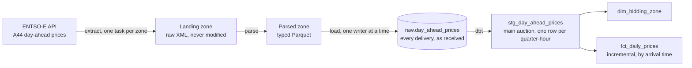

# European day-ahead electricity prices: a batch ELT pipeline

[](https://github.com/OtoTediashvili/energy-data-pipeline/actions/workflows/ci.yml)

Every day at 13:00 UTC this pipeline collects the next day's wholesale electricity prices for the Netherlands, Belgium, Austria and the Czech Republic from ENTSO-E, the European grid operators' transparency platform, and turns them into a tested star schema. The data is real and badly behaved: it changes resolution mid-year, crosses clock changes, mixes two auctions in one response and sends some series twice. The interesting part of this repo is how each of those was found and handled.

| | |
|---|---|
| **History** | 379 market days per zone on 13 Oct 2026 (from 30 Sep 2025, no gaps), growing daily |
| **Grain** | ≈145,000 quarter-hour prices in staging; one row per zone per day in the fact table |
| **Stack** | Airflow 3 · dbt · DuckDB · Python 3.12 · Docker Compose · GitHub Actions |
| **Tests** | 91 Python tests (97% coverage), 10 DAG tests under Airflow, 32 dbt tests, all in CI |

## Architecture



Airflow runs it daily with one task per zone for extract, parse and load. A **validate** gate fails the run if any zone loaded nothing, and **dbt build** fails it if any of the 32 tests fails.

## Quickstart

You need Docker, `make`, [uv](https://docs.astral.sh/uv/), and a free ENTSO-E API token: register at [transparency.entsoe.eu](https://transparency.entsoe.eu), then request API access by email.

```bash
git clone https://github.com/OtoTediashvili/energy-data-pipeline && cd energy-data-pipeline
make install                 # virtualenv, dependencies, pre-commit hooks
cp .env.example .env         # put your token in PIPELINE_SOURCE_API_KEY, in an editor
make check                   # lint, types, tests: the same checks CI runs
make up                      # builds the image; Airflow on http://localhost:8081
make password                # the generated admin password
make unpause                 # starts the daily schedule and catches up to today
```

Load history once the catch-up is done (one command, about an hour for a year):

```bash
make backfill FROM=2025-10-03 TO=2026-09-20
```

On Windows, run everything inside WSL2, from a folder in the Linux filesystem.

## The data, and what it does to a pipeline

| Behaviour of the source | Consequence | Handled by |
|---|---|---|
| Market days run on Brussels time; the API speaks UTC | One UTC request spans two market days; clock-change days have 92 or 100 quarter-hours | Every row carries absolute timestamps; `market_date` is derived in staging with a zone-aware conversion |
| Resolution went from hourly to 15 minutes on 1 Oct 2025 | Counting intervals no longer proves a day is complete | `covered_minutes` must be 1380, 1440 or 1500; intervals must never overlap |
| Curve type A03 omits a point when the price is unchanged | Missing positions are not missing data | Forward-filled and flagged `is_filled`; a gap in an A01 curve fails the parse |
| Errors and "no data" arrive as an `Acknowledgement` document, sometimes with HTTP 200 | A successful request can carry no prices | Never written to the landing zone; the error carries ENTSO-E's reason |
| Corrections are republished with a higher `revisionNumber` | The same quarter-hour arrives several times | Raw keeps every delivery; staging keeps the highest revision, then the newest delivery |
| Austria has two day-ahead auctions in one response | Two prices for every quarter-hour | Staging keeps the main European auction ([see below](#what-broke)) |
| In 2026 data, some series arrive twice in one document | Exact duplicates | Allowed; two *different* prices for one interval fail a test |

Volume is small: four requests a day, a few dozen KB each. This project is about correctness under messy data, not throughput.

## Design decisions

**Three storage zones, each rebuildable from the one before.** The landing zone holds the bytes exactly as received, at a path determined by zone and day. The parsed zone holds one typed Parquet file per landed file. Raw is a log of deliveries. A parser bug is fixed by parsing again from disk, never by re-downloading from a rate-limited API.

**Every write replaces exactly one delivery.** Loads delete and insert one file's rows inside a single transaction, keyed on the file's path. A rerun can't duplicate data, a failed load can't empty a day, and two zones loading the same day can't touch each other's rows. Inserts match columns by name, so a reordered file can't silently swap `interval_start` and `interval_end`.

**Raw keeps everything; staging decides.** Both auctions, every revision and every duplicate land in raw. Choosing a price is a modelling decision, so it lives in dbt, where it's tested and documented, not in the parser.

**The fact table is incremental by arrival time, not by date.** Each build rebuilds every day that received data since the last build, however old the day is. An earlier version rebuilt a 7-day window behind the newest day, and backfilled days never reached the table, while every test still passed. A reconciliation test now compares the fact table with staging, day by day.

**DuckDB, with one writer at a time.** A file-based warehouse is right for one machine and this volume. It allows one writer, so extract and parse fan out per zone while loads run one after another. dbt is skipped inside backfill runs, and one build runs at the end.

**Backfills go through a script, because Airflow 3's backfill has sharp edges.** These were all found by testing:
- Backfill runs never start while the DAG is paused.
- A backfill ignores the DAG's `max_active_runs` setting.
- If a backfill ends up as the newest run, the scheduler fills every day after it with empty "successful" runs.

`make backfill` checks for each of these, waits for the backfill to finish and then builds the marts.

**The token never reaches a log.** ENTSO-E reads the token from the URL, and both httpx logs and Airflow's tracebacks print URLs. Tests capture every logger at every level, and walk every traceback frame's local variables, to prove it never appears.

**At 100× the volume** I would move the landing zone to object storage and the warehouse to BigQuery, or to Iceberg tables. That removes the single-writer bottleneck, so loads could run in parallel. Staging would become incremental too, partitioned by month, rather than a view over all of raw.

## What broke

The best bug in this project was found by a three-day trial backfill, and it affected every Austrian price the pipeline had loaded until then.

Before backfilling a year, I backfilled three days around **1 October 2025**, the day European day-ahead prices moved from hourly to 15-minute resolution. One row failed the completeness test: Austria, 30 September, **2205 minutes** in a 1440-minute day.

Two queries diagnosed it. Raw held both 15-minute and hourly rows for that day. The XML showed why: Austria's response contains **two auctions**, labelled `classificationSequence` position 1 and position 2. Position 1 is the main European auction. Position 2 is [EXAA's separate 10:15 auction](https://github.com/JaccoR/hass-entso-e/issues/272). The parser ignored the label, so staging deduplicated across both. On 30 September the two auctions had different resolutions, so the mix produced an impossible day: 17 hourly prices overlapping 79 quarter-hours.

The worse part came after that day. From 1 October both auctions are quarter-hourly with **identical timestamps**, so staging kept one of the two prices per quarter-hour more or less at random, and every test passed. Every Austrian price loaded until then had been a mix of the two auctions.

The fix:
- The parser now records each row's auction.
- Staging keeps the main auction, and chooses it *before* ranking revisions, so a newer EXAA correction can never win.
- New tests check that intervals never overlap, that every day in raw reaches staging, and that no interval ever has two prices within one delivery.

Each new check was mutation-tested: with the filter removed or moved in three different ways, a unit test and a separate data test each caught every variant.

**Other things the checks caught before they shipped:**

| What would have gone wrong | How it was caught | Fix |
|---|---|---|
| Backfilled days would never reach the fact table | Rehearsing the backfill on a copy | Rebuild by arrival time, plus a reconciliation test |
| A short backfill would flood Airflow with hundreds of empty runs | Rehearsing on real Airflow | `make backfill` refuses to end after the newest scheduled run |
| Loading Belgium deleted the Netherlands' rows for the same day | Test with two zones on one day | Replace by delivery, not by date |
| In winter, tomorrow's prices would arrive a day late | Tests for both seasons and both clock changes | Request window runs to the next UTC midnight |
| Three of four parallel loads failed with a DuckDB lock error | The first four-zone run | Loads serialised; extracts still parallel |
| The token appeared in httpx's INFO logs | A test capturing every logger | httpx logging turned down; errors redacted before they are raised |
| A new check rejected ENTSO-E's harmless duplicate series | The first real run after adding it | The rule became "never two *different* prices". Its first version came from assumptions, not from real data |

## Testing and quality

| Layer | What it covers |
|---|---|
| **Parser** (pytest) | A real ENTSO-E document plus edge cases: A03 gap-fill, A01 gaps, 92- and 100-quarter-hour days, two auctions, acknowledgements, namespace version bumps |
| **Extract** (pytest + respx) | Retries on 5xx and connection errors, fails fast on 4xx, idempotent landing paths, the token in no log, no traceback and no landed file |
| **Load** (pytest + real DuckDB) | Atomic replacement, a pinned schema, by-name inserts, zones isolated from each other |
| **DAG** (pytest under Airflow 3.0.2, in CI) | Task order, one task per zone in the seed, serialised loads, dbt skipped only in backfills |
| **dbt unit tests** | Revision ranking, market days across clock changes, main-auction choice, incremental rebuild by arrival |
| **dbt data tests** | Uniqueness, referential integrity, accepted values, completeness in minutes, no overlaps, conflicting prices, staging-to-fact reconciliation |
| **CI** (GitHub Actions) | Four jobs: lint, types, tests and shellcheck · DAGs import under the pinned Airflow version · dbt build on sample data · secret scan of the full git history |

```bash
make check         # ruff, mypy, pytest
make build-marts   # dbt build and test against the local warehouse
```

## Operating it

| Command | What it does |
|---|---|
| `make up` / `make down` | Start or stop Airflow (UI on `localhost:8081`) |
| `make unpause` | Start the daily schedule; catches up from the start date |
| `make backfill FROM=… TO=…` | Load history with guard rails, then build the marts once; `REPROCESS=failed` retries failed days |
| `make build-marts` | Run dbt build and tests now, outside a DAG run |
| `make reset-history` | Delete the DAG's run history (works after backfills too); waits until the DAG is back |
| `make reset-data` | Wipe the landing zone, parsed files and warehouse |

## Repo layout

```
dags/day_ahead_prices.py    Orchestration only: extract → parse → load → validate → dbt
src/pipeline/               extract (HTTP, landing), parse (XML → Parquet), load (DuckDB), config
dbt/models/staging/         Main auction, casts, market days, one row per quarter-hour
dbt/models/marts/           dim_bidding_zone, fct_daily_prices
dbt/tests/                  Reconciliation and invariant tests
dbt/seeds/                  Bidding zones (the DAG reads its zone list from here), CI sample data
scripts/                    backfill.sh, build_marts.sh, workstation bootstrap
tests/                      pytest suite and real ENTSO-E fixtures
```

## What's next

- **Deploy to the cloud:** Terraform, object-storage landing, a managed warehouse, secrets in a secret manager.
- **Alerting:** a failed run is currently visible only in the Airflow UI.
- **Replay from landing:** rebuild raw from the stored files after a schema change, instead of downloading again.
- **Source freshness checks inside the DAG**, so a stalled source fails loudly rather than quietly.
- **A small serving layer:** a dashboard of daily prices and negative-price hours per zone.
